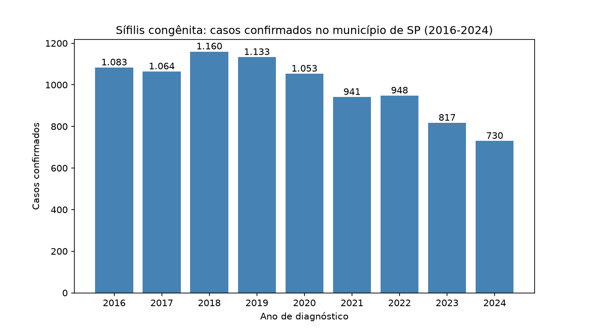

# Analisador de Dados de Saúde: Sífilis Congênita

Projeto em Python que analisa casos confirmados de sífilis congênita
no município de São Paulo, usando dados públicos do DATASUS (SINAN/TabNet).

## O que o programa faz
- Lê o arquivo CSV exportado do TabNet
- Calcula total, média, maior e menor número de casos por ano (2016 a 2024)
- Mostra a variação percentual de um ano para o outro

## Como usar
1. Coloque o CSV na pasta `dados/` com o nome `sifilis_congenita_sp.csv`
2. Rode: `python analise.py`

## Observações
- 2025 ficou de fora porque os dados vão só até junho de 2025 (ano incompleto).
- Dados sujeitos a revisão pelo Ministério da Saúde.

## Próximos passos
- Gráficos com matplotlib
- Comparação com a zona norte (CRS Norte) usando dados da Prefeitura de SP

## Gráfico dos casos

O gráfico abaixo mostra a quantidade de casos confirmados de sífilis congênita entre 2016 e 2024.

